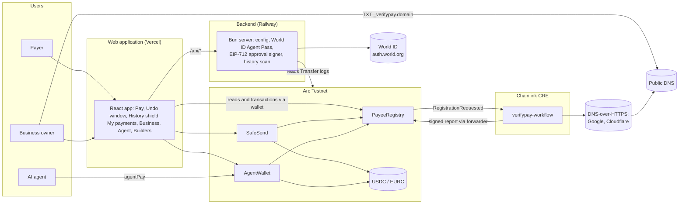
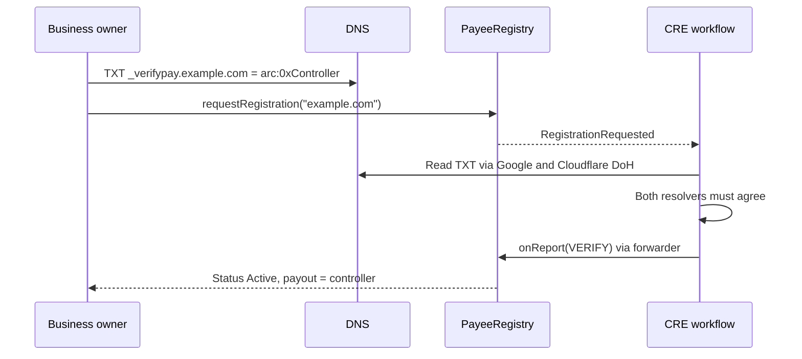
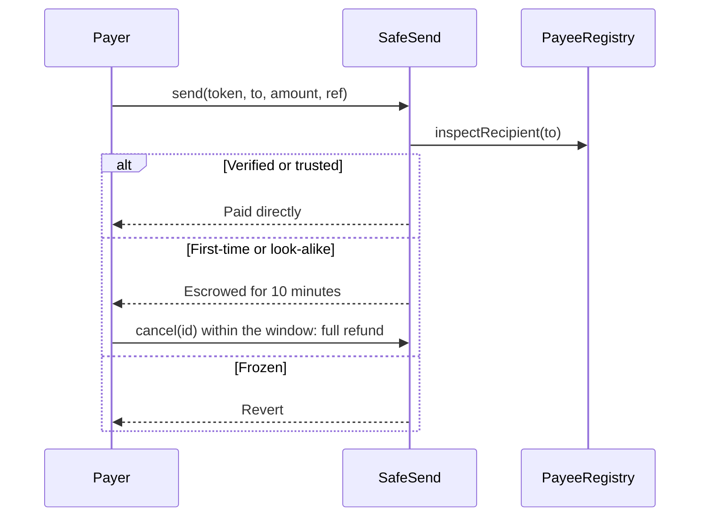

# Architecture

This document describes how VerifyPay is built: its components, how data moves between them, where each part runs, and
what each part is trusted to do.

## System overview

## Components

### Smart contracts (`src/`, Solidity 0.8.28)

**PayeeRegistry** maps a domain to a business's controller and payout wallet, with a status of None, Pending, Active or
Frozen.

- `requestRegistration(domain)` emits `RegistrationRequested`, which starts the CRE workflow.
- `onReport(metadata, report)` accepts reports only from the configured CRE forwarder (and, in production, only from the
  expected workflow owner). A report is `abi.encode(domainHash, controller, leiHash, action)`, where action 1 verifies
  and action 2 freezes.
- A verify report that names a different controller than the current one does not take effect immediately: the payee is
  frozen and the new controller waits `changeDelay`, during which the current controller can cancel.
- Payout changes need the controller, an EIP-712 approval from the backend signer, and `changeDelay`. The current payout
  wallet can cancel.
- `inspectRecipient(address)` returns Verified, Frozen, Lookalike or Unknown. A look-alike is an address whose
  fingerprint (first 4 and last 4 hex characters) matches a registered payout wallet. Such an address can never be
  registered as a payout wallet.

**SafeSend** moves USDC and EURC.

- `payByName(token, domainHash, amount, ref)` pays an Active business directly, in one transfer.
- `send(token, to, amount, ref)` checks the recipient with the registry. A verified or previously trusted address is
  paid directly. A first-time or look-alike address is escrowed for `undoWindow` (600 seconds). A frozen business is
  rejected.
- `cancel(id)` returns an escrow to its sender during the window. `release(id)` pays the recipient after it.
- Every function that moves funds is `nonReentrant` and emits an event (`Paid`, `Escrowed`, `Cancelled`, `Released`).

**AgentWallet** holds funds for an AI agent.

- `agentPay(token, domainHash, amount, ref)` pays only Active businesses, within per-payment and per-day limits that
  start at zero.
- `raiseLimits` needs an EIP-712 approval that the backend issues only after a World ID approval. `lowerLimits`,
  `setPaused` and `withdraw` are owner-only and take effect immediately.

The contracts have no admin role after deployment: no owner on the registry or SafeSend, no upgrade path, no pause, and no
way for the team to move user funds or unfreeze a business.

### Chainlink CRE workflow (`cre/verifypay-workflow/`)

| Trigger | Source | Action |
|---|---|---|
| 0: EVM log | `RegistrationRequested` on PayeeRegistry | Check the domain, write VERIFY if the proof is valid |
| 1: Cron | Schedule (daily in the workflow config) | Re-check every payee, write FREEZE if the proof is gone, VERIFY if it returned |

For each domain the workflow reads TXT `_verifypay.<domain>` from `dns.google` and `cloudflare-dns.com` with
`consensusIdenticalAggregation`, so every node must return the same result. Both resolvers must return
`arc:<controller address>`. An optional `lei:<LEI>` record is checked against GLEIF. The decision is written with
`writeReport` through the forwarder to `PayeeRegistry.onReport`.

`cre/runner/runner.mjs` starts this workflow automatically with the official CRE CLI until DON deployment access is
granted: it polls for `RegistrationRequested` every 20 seconds, runs trigger 0 for each Pending domain, and runs trigger 1
every 30 minutes. With deployment access, `cre workflow deploy` replaces the runner.

### Backend (`studio-app/server/`, Bun)

| Route | Purpose |
|---|---|
| `GET /api/config` | Chain, RPC, explorer and contract addresses for the web application |
| `POST /api/agent-pass/start` | Starts a World ID device authorization for a payout change or a limit raise |
| `POST /api/agent-pass/poll` | Polls World ID; on approval validates the ID token and returns the signed EIP-712 approval |
| `GET /api/history-scan?address=` | Finds poisoning attempts in an address's history |

- **World ID Agent Pass.** The backend runs the OAuth 2.0 device authorization flow (RFC 8628) against
  `auth.world.org`, requiring an Orb-verified human. It validates the ID token's signature, issuer, audience, expiry and
  authentication time before signing.
- **Same-human binding.** The first World ID subject that approves an action for a business or agent wallet becomes its
  owner. Later approvals from a different subject are refused.
- **Approval signer.** The signer key exists only in the backend's environment. Before signing, the backend confirms that
  the deployed PayeeRegistry and AgentWallet report the same `approvalSigner()`. The signature is a narrow EIP-712
  message (`PayoutChange` or `RaiseLimits`) bound to chain ID, contract, nonce and deadline.
- **History scan.** Combines the Arc explorer's token-transfer list with raw `Transfer` logs read over RPC, because the
  explorer omits zero-value transfers, which are the usual poisoning vector. A transfer is flagged when its counterparty
  matches the fingerprint of an address the user has really paid but is not that address.

### Web application (`studio-app/src/`, React, Vite, viem)

- The **Pay** tab shows a live verdict for a typed domain or pasted address, approves the exact amount, and calls
  `payByName` or `send`. It also contains the **Undo window**, **My payments** (from `Paid` and `Escrowed` events) and the
  **History shield**.
- The **Business** tab handles registration, status, and payout changes with World ID.
- The **Agent** tab shows the agent wallet's limits, funding and pause state, and raises limits with World ID.
- The **How it works** tab shows the live CRE evidence. The **Builders** tab offers a live `inspectRecipient` check and
  integration snippet.
- All transactions go through one `write()` function that simulates first (so reverts show the contract's named
  error), sends through the user's wallet, waits for the receipt and refreshes the affected views.

## Key flows

### Registration and verification

### Paying an address

### Automatic freeze

The scheduled trigger lists every payee with `domainCount` and `domainAt`, re-reads each DNS record, and writes FREEZE for
any Active payee whose record is missing or no longer matches. From that block on, `payByName` and `agentPay` to that
business revert, and `send` to its wallet is rejected.

### Payout change with World ID

1. The business owner requests a change in the Business tab.
2. The backend starts a World ID device flow; the owner approves in World App.
3. The backend validates the result, checks the same-human binding, and signs a `PayoutChange` approval.
4. The controller calls `requestPayoutChange` with that approval. The change waits `changeDelay`.
5. During the delay the current payout wallet or the controller can cancel. Afterwards anyone can execute it.

## Deployment

| Part | Where it runs | Notes |
|---|---|---|
| Contracts | Arc Testnet (chain 5042002) | Deployed and source-verified from Arc Studio |
| Web application | Vercel | Forwards `/api/*` to the backend (`studio-app/vercel.json`) |
| Backend | Railway | Secrets only in Railway environment variables |
| CRE workflow | Official CRE CLI, started by `cre/runner` | DON deployment pending access |
| Business DNS proof | The business's own DNS provider | Demo domain: `pay.chrsnikhil.info` |

### RPC usage

The public Arc RPC limits requests per client IP, and a user's wallet shares that limit with any page they have open. The
web application therefore reads through Arc's partner endpoints listed in Arc's documentation, with fallback:
Blockdaemon (`rpc.blockdaemon.testnet.arc.io`), then the public RPC, then dRPC. The CRE workflow and runner use
Blockdaemon. Log queries are split into ranges of 10,000 blocks, the largest the endpoints accept.

## Trust boundaries

| Component | Can do | Cannot do |
|---|---|---|
| CRE workflow and forwarder | Verify or freeze a business | Move funds; change a controller without the delay |
| DNS and the DoH resolvers | Prove control of a domain | Bypass the delay on a controller change |
| Backend approval signer | Authorize a payout change or a limit raise | Move funds; skip the public delay; override a cancel |
| World ID | Prove a fresh approval by the same verified human | Act without the controller's transaction |
| Deployer and team | Deploy | Withdraw, pause, upgrade, unfreeze or change any business |

The full threat model is in [docs/security.md](docs/security.md).
