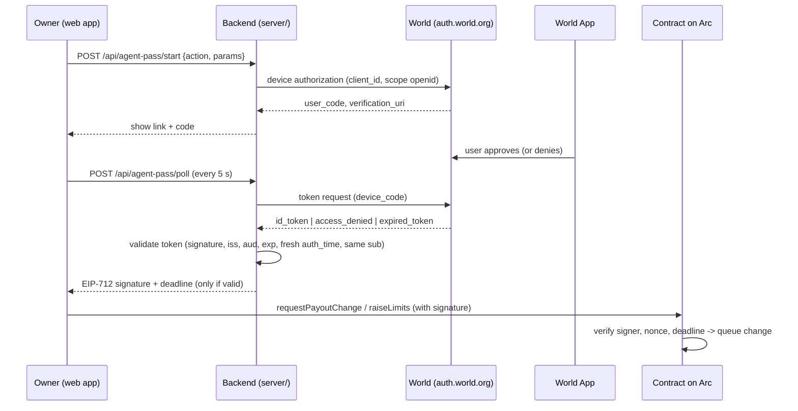

# World ID Agent Pass: integration guide

Track: **World ID Agent Pass ($5,000)**. Agent Pass is the official World ID flow at `auth.world.org`.
The issuer's discovery document advertises only Orb-level verification (`acr_values_supported`: orb, orb-face), so an
approval comes from an Orb-verified human using World App.

## Prize requirements and how VerifyPay meets them
| World requirement | VerifyPay |
|---|---|
| Integrate the official World ID Agent Pass | Backend uses the issuer `https://auth.world.org` via OIDC discovery (`/.well-known/openid-configuration`), no hard-coded endpoints (`server/src/oidc.js`) |
| Complete journey: request → user completion → validated result → protected action | Web app starts the request → user approves in World App → backend validates the ID token → backend signs an EIP-712 approval → contract performs the protected action |
| A denied / expired / cancelled path where the action does not occur | `access_denied`, `expired_token` and validation failures return no signature; the UI shows "Nothing changed"; the contract rejects any change without a valid signature |
| Validate in a secure backend (no client secrets, never trust client responses) | ID token checked server-side: JWKS signature, `iss`, `aud`, `exp`, `iat`, **`auth_time` after the request started (fresh)**, `sub`; client secret only in server env |
| Meaningful action needing a human, not a login screen | Two money-moving moments (below) |
| Short debrief | `docs/world-debrief.md` (time to first success, friction, missing capability/docs, top improvement) |

## The two protected actions
1. **Changing a business's payout wallet** (`PayeeRegistry.requestPayoutChange`): the exact moment "we changed our wallet" fraud happens. After World approval, the change still waits a public delay (2 min demo / 48 h production), payments keep going to the old wallet, and the old wallet can cancel.
2. **Letting an AI agent spend more** (`AgentWallet.raiseLimits`): an agent's per-payment/daily caps can only be raised after a fresh human approval. Lowering needs none.

**Same-human binding:** the first World ID (`sub`) that approves for a payee/wallet becomes its owner; approvals from a different person are rejected (`server/data/bindings.json`).

## Flow

## Contract side (what the signature authorizes)
- `PayoutChange(bytes32 domainHash,address newPayout,uint256 nonce,uint256 deadline)`, domain `{name:"VerifyPay", version:"1", chainId, verifyingContract: PayeeRegistry}`
- `RaiseLimits(address wallet,address token,uint128 perPayment,uint128 perDay,uint256 nonce,uint256 deadline)`, domain `{name:"VerifyPayAgentWallet", version:"1", chainId, verifyingContract: AgentWallet}`
- Per-target nonces stop replay; deadlines expire approvals; malleable signatures rejected. `test/Eip712Compat.t.sol` proves the backend's typed data matches the contracts.

## Setup
1. Register the app at https://auth.world.org/portal; note client id (and secret if issued).
2. `server/.env`: `WORLD_ISSUER=https://auth.world.org`, `WORLD_CLIENT_ID`, `WORLD_CLIENT_SECRET`, `WORLD_SCOPE=openid`, `WORLD_CLIENT_AUTH=basic` (must match the method chosen at registration), `APPROVAL_SIGNER_KEY` (its address is the contracts' `approvalSigner`).
3. Check `https://auth.world.org/.well-known/openid-configuration` lists `device_authorization_endpoint`.
   [ASSUMPTION] The backend uses the device flow (another team used it). If World only offers authorization-code, replace `startDeviceFlow` / `pollDeviceToken` with a redirect + code exchange; `validateIdToken` stays unchanged. Confirm at the World booth.
4. `cd server && npm i && npm test && npm start` (13 tests incl. forged signature, `alg: none`, wrong iss/aud, expired, stale login, denied/expired mapping).

## Evidence for judging
- [ ] Video: **Deny** in World App → "Nothing changed", no transaction
- [ ] Video: **Approve** → `requestPayoutChange` tx → countdown → old wallet can cancel
- [ ] Video: raise agent limits with World approval
- [ ] Backend validation code shown (`server/src/oidc.js` → `validateIdToken`)
- [ ] `docs/world-debrief.md` filled in

## Not entered: World IDKit track ($2,500)
IDKit needs a credential verified at a trust moment (e.g. Proof of Human when a business registers, to stop one person registering many look-alike businesses). Not built; only enter that track if you add it and verify the proof server-side.
