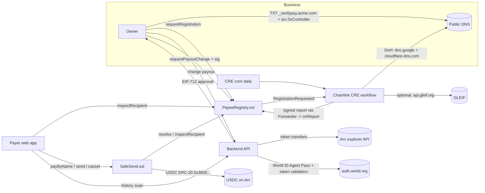

# 02 · TRD

## Architecture

## On-chain vs off-chain
| Concern | Where | Why |
|---|---|---|
| Payee status, payout, delays, escrow, fingerprints | Arc contracts | Must be enforceable and readable by anyone; nobody (incl. us) can bypass |
| DNS / GLEIF checks | Chainlink CRE | Real-world data; DON consensus instead of one server key |
| Agent Pass validation | Backend | World's flow is OIDC-style and must be validated server-side; output is a narrow EIP-712 approval |
| History scan | Backend (explorer API) | Read-only UX hint; no trust needed; expensive to do on-chain or in CRE |

## Data flow per action
- **Register:** owner sets TXT → `requestRegistration` → event → CRE log trigger → 2× DoH consensus → `onReport(VERIFY)` → Active.
- **Re-check:** CRE cron → `domainCount/domainAt` → DoH → mismatch → `onReport(FREEZE)` → Frozen.
- **Pay by name:** `payByName(hash, amount, ref)` → `resolve` → Active → `transferFrom(payer → payout)`.
- **Pay address:** `send(to)` → `inspectRecipient` → Verified: direct; Lookalike/first-time: escrow; Frozen: revert.
- **Undo:** `cancel(id)` → USDC back to sender. **Release:** after window, anyone → recipient.
- **Rotate payout:** backend runs Agent Pass → validates token → signs `PayoutChange(domainHash,newPayout,nonce,deadline)` → controller calls `requestPayoutChange` → wait `changeDelay` → `executePayoutChange` (or cancel).

## Chain choice
Arc Testnet (chain 5042002): USDC is the gas token (no second token for users), deterministic finality on inclusion, required by the Arc prize. RPC `https://rpc.testnet.arc.io`, explorer `https://explorer.testnet.arc.io`.

## Trust model
| Component | Can do | If it fails or is malicious |
|---|---|---|
| CRE DON + Forwarder | Verify / freeze payees | Can freeze (DoS) or verify a domain whose DNS it can't actually see; cannot move funds; any controller change is delayed and cancellable |
| DNS (and DoH resolvers) | Proves domain control | DNS hijack → payee freezes, new key delayed; owner cancels. Production: require DNSSEC (`requireDnssec: true`) |
| Backend approval signer | Starts a payout change | Can only queue a delayed change; old wallet/controller can cancel; cannot move funds |
| World ID | Proves a fresh human approval | Proofs are mocked by World at the event [stated in README] |
| Deployer | Deploys | No admin functions after deploy: no owner, no upgrade, no pause |

## Gas and scale
- Look-ups O(1) via mappings; `domainAt` enumeration is view-only (cron reads).
- Cron writes one report per changed payee; production would batch or move to event-driven re-checks.
- Fingerprint space is 2^32; real collisions are possible at scale → production uses 6+6 hex and per-payer history.

## What changes for production
Production Forwarder `0x76c9cf548b4179F8901cda1f8623568b58215E62` + `expectedAuthor`; 48h delay; DNSSEC required;
wider fingerprints; EIP-2612/EIP-3009 for gasless approvals; audit.
